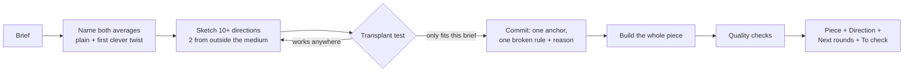

<div align="center">

# Directing Creative Work

**Stop getting the average. An Agent Skill that makes AI agents direct creative work instead of predicting it.**

[](CHANGELOG.md)
[](LICENSE)
[](https://agentskills.io)
[](#-any-language)
[](#requirements)
[](https://github.com/D3Br4nd/Directing-Creative-Work/stargazers)


[Quick start](#-quick-start) · [Examples](#-examples) · [How it works](#-how-it-works) · [Installation](#-installation) · [Credits](#-credits)

</div>

---

Ask an AI for a tagline, a name or a landing page and you get the most probable answer: the one everyone else gets too. Ask it to be original and you get the *first clever twist*, which is just as predictable.

**Directing Creative Work** gives the agent a creative director's habits. It names the average and the obvious twist, throws both away, starts from something only your brief contains, breaks one convention on purpose and says why. Then it hands you the finished piece, not an essay about it.

## ✨ Highlights

| | |
|---|---|
| 🎯 **Two averages, both banned** | The plain version *and* the first clever twist are named and ruled out before work starts. |
| 🧪 **Transplant test** | If an idea would work unchanged for a competitor, another street or another product, it goes. |
| 🔨 **One broken rule, with a reason** | One convention of form is broken on purpose, tied to what the reader should feel. No reason, no break. |
| 🧾 **Never invents facts** | Anything you didn't give, like a price, date or claim, becomes a `[placeholder]`, listed in a final "To check" line. |
| 🛡️ **Hard constraints stay hard** | Facts, brand rules, length, accessibility and working code are never the rule it breaks. |
| 🔁 **Next rounds** | Three directions for the next iteration: two runners-up and a sharper push. |
| 🌍 **Any language** | Written in English, replies in yours, headings included. |

## 🚀 Quick start

```bash
npx skills add D3Br4nd/Directing-Creative-Work
```

Then just ask for something creative:

> *"Write the window sign for my bakery. Nothing generic."*

No setup, no dependencies, no API keys: the skill is pure instructions. Other install options are [below](#-installation).

## 🖼️ Examples

<table>
<tr>
<th width="50%">You ask</th>
<th width="50%">You get</th>
</tr>
<tr>
<td>

*"Make this less generic. It's the hero of our landing page for a shared shopping-list app for flatmates:"*

> Empower your household with seamless collaboration. Organize, share and simplify your life.

</td>
<td>

> **Three ketchups. No loo roll.**
>
> One list the whole flat adds to, so whoever's at the shop buys what's actually run out.

</td>
</tr>
<tr>
<td>

*"Scrivi il testo per la vetrina di un panificio che apre il 3 dicembre in via del Pratello a Bologna. Si chiama Forno Nero, lievitazione naturale, apre alle 7. Massimo 60 parole."*

</td>
<td>

> In via del Pratello si fanno le ore piccole.
> Il nostro pane pure: lievitazione naturale, nessuna fretta.
>
> Alle 7 apriamo la porta.
> Chi torna a casa e chi è appena uscito
> si incrociano qui, davanti alla stessa pagnotta.
>
> **FORNO NERO**
> dal 3 dicembre

</td>
</tr>
</table>

<details>
<summary><b>See a complete reply, with its Direction notes</b></summary>

<br>

*"Make the message our banking app shows when a bank transfer fails more creative. Right now it says: 'Error 402. Operation failed.'"*

```markdown
**Your [amount] to [recipient name] didn't go through.**

Your balance right now: **[balance]**

[reason]

**[ Try again ]**   [ Edit transfer ]

Calling us about it? Mention code 402.

---
**Direction**
- Avoided: "Oops, something went wrong," and the playful "your money took a detour."
- Broken rule: error screens don't usually show account data, but this one shows the
  balance because the customer's first worry is whether money left, and a number
  answers that faster than reassurance can.
- Anchor: a bank teller sliding your slip back across the counter so you see your
  money before you hear why.
- For: someone whose rent or payment didn't go through, who should feel steady.

**Next rounds**
1. Write a one-line [reason] for each case that triggers 402, so no customer ever sees a bare code.
2. Add a "Let [recipient name] know it's late" button, because the other person is often the real worry.
3. A version for when the money did leave and is coming back: "[amount] will be back in your account by [date]."

**To check**: Fill in [amount], [recipient name], [balance] and [reason]. Also check what
402 covers in your system, and whether a failed transfer can ever take money out of the
account for a while. If it can, use the third option above for that case.
```

No jokes where money is at stake, no invented facts, and the creativity goes into warmth and precision.

</details>

## 🧠 How it works



When you reply with feedback, the agent treats it as information about what didn't land and goes round again from the choice of direction, changing the piece instead of defending it.

### What a reply looks like

```markdown
[The finished piece]

---
**Direction**
- Avoided: the average version and the first clever twist
- Broken rule: the convention, because of its effect on the reader
- Anchor: the specific reference the piece grew from
- For: who receives it and what it should make them feel

**Next rounds**
1. Runner-up direction
2. Second runner-up direction
3. A sharper push on the chosen piece

**To check**: placeholders to fill and facts to confirm
```

- **Names and taglines** lead with a recommendation plus four to six alternatives.
- **Several options** each get their own short direction, then one shared list of next rounds.
- **Sensitive text** (errors, health, money, condolences) gets clarity and warmth, not jokes; "Broken rule: none" is a valid answer.

### 🌍 Any language

The skill is written in English and answers in the language of your request, translating its headings: an Italian brief gets *Direzione* and *Prossimi giri*, a Spanish one *Dirección* and *Próximas rondas*.

## 📜 Principles

The idea for this skill came after reading [HUMAN.md](https://www.human-md.ai/), the manifesto by Briana (Mazzio) May.

| Principle | How the agent applies it |
|---|---|
| Break the rule on purpose | Breaks one convention of form and states why; without a reason, the rule stays |
| Find the thing in the strange place | Sketches at least ten directions, two from outside the medium, and keeps three |
| Defend the human | Judges the work by how the person receiving it experiences it |
| Emotional resonance, not correctness | Uses tension, surprise, restraint, a concrete detail and a line that ends one beat early |
| Pursue delight, not delivery | Adds one moment of delight, dosed to the context |
| Experiment and make | Delivers the finished work, not an essay about how it could be made |
| Own the result | If the result is average, fixes it before delivering |
| Design together | Closes with three next rounds and uses feedback to redo the work, not to defend it |

Two rules are this skill's own: **hard constraints are never broken**, and **facts are never invented**. An original piece that misleads or doesn't work has failed.

The full list of defaults to avoid, by medium, plus the second-order defaults and the moves worth trying, lives in [`references/average-defaults.md`](skills/directing-creative-work/references/average-defaults.md).

## 📦 Installation

The skill is the [`skills/directing-creative-work/`](skills/directing-creative-work/) folder. Pick one:

**Any agent, one command** (uses the community [`skills` CLI](https://github.com/vercel-labs/skills)):

```bash
npx skills add D3Br4nd/Directing-Creative-Work
```

**Manual copy:**

```bash
git clone https://github.com/D3Br4nd/Directing-Creative-Work.git
cp -R Directing-Creative-Work/skills/directing-creative-work ~/.claude/skills/
```

| Agent | Project only | All projects |
|---|---|---|
| Claude Code | `.claude/skills/` | `~/.claude/skills/` |
| OpenAI Codex | `.agents/skills/` | `~/.agents/skills/` |
| OpenCode | `.opencode/skills/` | `~/.config/opencode/skills/` |
| Google Antigravity | `.agents/skills/` | `~/.gemini/config/skills/` |

<details>
<summary><b>claude.ai</b></summary>

<br>

Zip the folder and upload it as a custom skill in claude.ai settings (needs a paid plan with code execution enabled):

```bash
cd skills && zip -r ../directing-creative-work.zip directing-creative-work
```

</details>

<details>
<summary><b>Claude Code tips</b></summary>

<br>

- Skills in `~/.claude/skills/` or `.claude/skills/` are picked up automatically. If `.claude/skills/` didn't exist when the session started, run `/reload-skills`.
- Invoke it explicitly with `/directing-creative-work`.
- Opened inside this repository, the skill is already available through the link in `.claude/skills/`.

</details>

## 💬 Usage

The skill activates on its own when you ask for creative work, or ask to make something less generic, in any language:

```text
"Write the window sign for my shop, nothing generic."
"This page sounds like an AI wrote it, give it some soul."
"Rendi più creativo il messaggio di benvenuto della nostra app."
"Dame un nombre fuera de lo común para la newsletter."
```

**Give it a brief:** what you need, who it's for, and any constraints (length, facts to include, brand rules). If the audience is missing, the agent picks a specific one and says so in the notes.

It stays out of the way for factual, technical or compliance writing, and for a bug fix or a data table.

<details>
<summary><b>Prompts to try after installing</b></summary>

<br>

1. *"Scrivi il testo per la vetrina di un panificio di quartiere che apre il 3 dicembre in via del Pratello a Bologna. Si chiama Forno Nero, fa pane a lievitazione naturale e apre alle 7. Massimo 60 parole."*
   Expect at most 60 words in Italian with every fact, no bakery clichés, built on something specific to the shop or the street, with Italian headings.
2. *"Can you make this less generic? It's the hero of our landing page for a shared shopping-list app for flatmates: 'Empower your household with seamless collaboration.'"*
   Expect a headline and subline built on a concrete scene from flat-sharing life, with no "empower" or "seamless" and no promised features the brief didn't mention.
3. *"Make the message our banking app shows when a bank transfer fails more creative. Right now it says: 'Error 402. Operation failed.'"*
   Expect a calm, clear message with no jokes. Whether the money was debited stays a placeholder, and "To check" lists what the team must confirm.
4. *"dame tres ideas fuera de lo común para el vídeo de lanzamiento de nuestro helado de sésamo negro"*
   Expect three ideas in Spanish on different anchors, each with its own short direction, and Spanish headings.

The full test cases are in [`evals/evals.json`](skills/directing-creative-work/evals/evals.json), and the activation queries, in five languages, in [`evals/eval_queries.json`](skills/directing-creative-work/evals/eval_queries.json).

</details>

## 🗂️ Project layout

```text
skills/directing-creative-work/
├── SKILL.md                        instructions and metadata
├── references/average-defaults.md  defaults to avoid and moves worth trying, by medium
└── evals/                          test cases and activation queries
scripts/validate_skill.py           validator, run before every commit
AGENTS.md                           rules for agents that maintain the repository
CHANGELOG.md                        release notes
```

### Requirements

None. The skill contains only instructions: no scripts, no network, no packages.

### Development

```bash
python3 scripts/validate_skill.py
```

The rules for changing the skill, including those that keep it agent-agnostic, are in [AGENTS.md](AGENTS.md). Issues and pull requests are welcome.

## 🙏 Credits

- [**HUMAN.md**](https://www.human-md.ai/) by Briana (Mazzio) May: the manifesto that sparked the idea. Its text is not reproduced here.
- [Agent Skills specification](https://agentskills.io/specification), [evaluating skills](https://agentskills.io/skill-creation/evaluating-skills) and [optimizing descriptions](https://agentskills.io/skill-creation/optimizing-descriptions).
- [Claude Code: skills](https://code.claude.com/docs/en/skills) and [Anthropic's skill authoring best practices](https://platform.claude.com/docs/en/agents-and-tools/agent-skills/best-practices).

## 📄 License

[MIT](LICENSE) © 2026 Max Brandini. The license covers the skill and the documentation in this repository, not the HUMAN.md manifesto.
